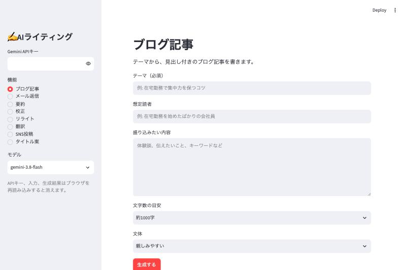

# AIライティング

ブログ記事の執筆、メールの返信、文章の要約など、文章作成に使う8つの機能を1画面にまとめたWebアプリです。

複数のAIツールを行き来しなくても、1か所で文章を作成、推敲できるようにしました。

**デモ:** https://ando625-writing-tools-app-lfstfw.streamlit.app/



## 機能

| 機能 | 入力するもの | 生成されるもの |
|---|---|---|
| ブログ記事 | テーマ、想定読者、盛り込みたい内容、文字数、文体 | 見出し付きの記事 |
| メール返信 | 受信メール、返信の要点、丁寧さ | 返信文 |
| 要約 | 文章、長さ、形式 | 要約文または箇条書き |
| 校正 | 文章 | 修正後の文章と修正理由 |
| リライト | 文章、トーン | 言い換えた文章 |
| 翻訳 | 文章、翻訳先の言語 | 翻訳文 |
| SNS投稿 | 伝えたい内容、媒体 | 投稿文3案 |
| タイトル案 | 記事や資料の内容、キーワード | タイトル候補10案 |

生成中の文章は順に表示され、完成した結果はコピーやダウンロードができます。

## 使い方

1. [Google AI Studio](https://aistudio.google.com/apikey) でGemini APIキーを取得します。
2. サイドバーにAPIキーを入力します。
3. 機能を選んで必要な項目を入力し、「生成する」を押します。

APIキーは利用者自身のものを使います。アプリはキーをファイルやログに保存せず、ブラウザを再読み込みすると入力欄から消えます。

> [!WARNING]
> Gemini APIの無料枠では、入力内容がGoogleのサービス改善に使われ、担当者が読む場合があります。個人情報や機密情報は入力しないでください。

## 技術構成

| 分類 | 使用技術 |
|---|---|
| 言語 | Python（3.14で動作確認） |
| 画面 | Streamlit |
| AI | Gemini API（`google-genai`） |
| テスト | unittest、Streamlit AppTest |
| 公開先 | Streamlit Community Cloud |

DBとログイン機能はありません。入力と生成結果はブラウザのセッション中だけ保持します。

## 設計

```text
ブラウザ
   │
   ▼
app.py ──────────▶ tools.py（機能の定義と送信文の組み立て）
   │
   ▼
gemini_client.py ─▶ Gemini API
```

| ファイル | 役割 |
|---|---|
| `app.py` | 画面の表示と操作の受付 |
| `tools.py` | 各機能の入力項目とAIへの指示 |
| `gemini_client.py` | API通信とエラーの案内文への変換 |
| `tests/` | 画面と通信処理のテスト |

機能の多くは「入力して文章を受け取る」という同じ形です。そこで、違いを `tools.py` のデータにまとめ、1件追加するだけで画面にも機能が増えるようにしました。

## 工夫した点

- **APIキーを預からない:** 利用者が画面で入力する方式にして、公開先に開発者のキーを置かないようにしました。
- **外部画像を読み込まない:** 文章内の罠にAIが従っても、画像の自動読み込みで入力内容が外部へ送られないようにしました。
- **エラーを安全に案内する:** 画面には次にすべきことを日本語で表示します。ログにはエラーの種類と発生箇所だけを記録し、キーや入力文は書きません。
- **途中の文章を失わない:** 生成の途中で失敗しても、そこまでの文章を残します。
- **依存パッケージを固定する:** 全パッケージの版とハッシュを固定し、中身が異なるものはインストールで止まるようにしました。
- **入力を失いにくくする:** 機能を切り替えても、入力中の文章が残るようにしました。

## ローカルでの起動

```bash
git clone https://github.com/ando625/writing-tools.git
cd writing-tools
python3 -m venv .venv
.venv/bin/python -m pip install -r requirements.txt
.venv/bin/streamlit run app.py
```

ブラウザで http://localhost:8501 を開きます。接続を自分のPCに限定する設定を読み込むため、プロジェクトのフォルダから起動してください。

`requirements.txt` はPython 3.14で生成しています。パッケージを変更するときは `requirements.in` を編集し、`pip-compile` で作り直します。

## テスト

実際のAPIは呼ばずに、次のコマンドで実行できます。

```bash
.venv/bin/python -m unittest discover tests
```

## 今後の課題

- CIとDependabotによる自動確認
- 必須項目の不足など、入力で止めた場合のログの記録
- 生成履歴の保存
